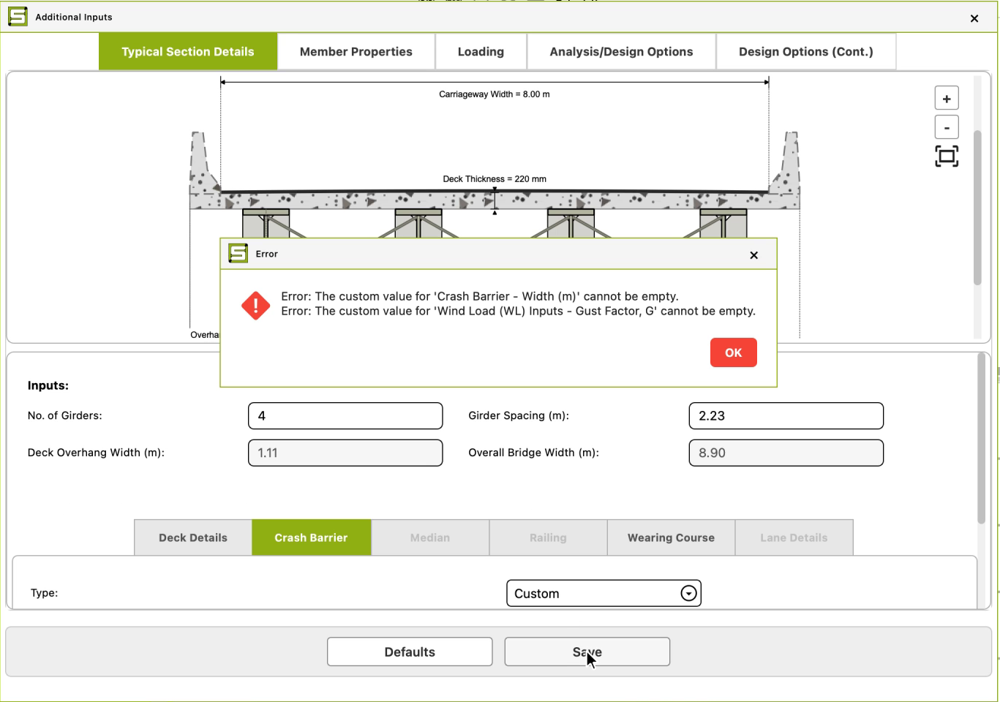
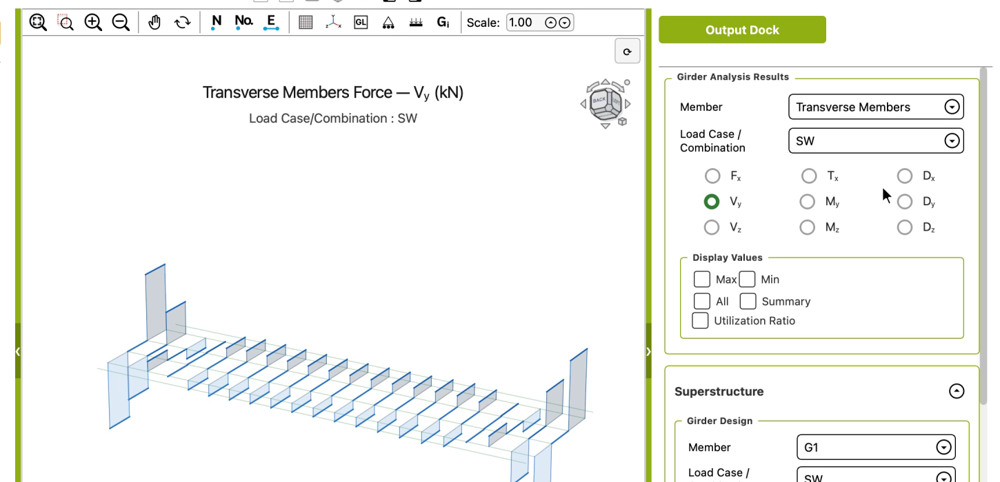

# OsdagBridge Screening Task Report
## UI, 2D CAD and Plotting Enhancements

**Name:** Pranav Shukla  
**Internship:** FOSSEE Winter Internship 2026, Osdag (Software Development)  
**Repository:** https://github.com/PranavShukla2/OsdagBridge (fork of Nidhikhare12/OsdagBridge, branch `dev`)  
**Video:** https://youtu.be/5JGVqugLyJ4

---

## 1. Overview

The task had three parts:

1. Editing four bridge dimensions directly on the 2D CAD by double-clicking their labels.
2. Validation and unsaved-change handling in the Additional Inputs dialog.
3. Result plots for transverse members (end diaphragms and cross bracings).

I worked on a fork of the repository, on top of the `dev` branch, and kept each change in its own commit so the history shows how the work progressed. Below I explain how I approached each part, what I changed and how I tested it.

All file paths below are relative to `src/osdagbridge/`.

---

## 2. Task I: Interactive 2D CAD parameter editing

### How the labels became clickable

The cross-section and top-view widgets (`CrossSectionCADWidget`, `TopViewCADWidget`) draw everything with `QPainter`, including the dimension text, so there is no widget under a label that could receive a click. To get around this, I changed `draw_text_with_background()` and the dimension-arrow helpers to return the rectangle they draw the text in. While painting, each widget now records that rectangle against the parameter it represents. Carriageway Width, Girder Spacing and Deck Thickness are recorded in the cross-section, and Span Length and Girder Spacing in the top view.

Overhang, Overall Bridge Width and Bracing Spacing are recorded as **locked**. These are derived from the other inputs: overall width comes from the carriageway, barriers and footpaths, overhang comes from the girder layout, and bracing spacing from the span and the number of bracings. Letting the user type them in would over-define the layout. Double-clicking one of them only shows a tooltip explaining that it is derived.

### Inline editor

The double-click logic is in a small mixin, `desktop/ui/docks/cad_label_editor.py`, that both widgets use:

- `mouseDoubleClickEvent` checks the recorded rectangles. If the click is on an editable label, a `QLineEdit` with a `QDoubleValidator` is placed over the label, pre-filled with the current value.
- **Enter** or clicking anywhere else (focus-out) applies the value; **Esc** cancels.
- Hovering an editable label shows a pointer cursor, a "Double-click to edit" tooltip and a thin green outline, so it is clear which labels can be edited.
- If two labels overlap on a small canvas, the one closest to the pointer is used.
- The widget itself does not change any data. It emits `dimension_value_edited(key, value)`, where `key` is the input key from `common.py` (for example `KEY_TS_GIRDER_SPACING`) and the value is already in that key's units. Editing is only enabled for the CAD on the main page, because the Typical Section preview in Additional Inputs reuses the same widget and should stay read-only.

### Writing the value back

`template_page.py` receives the signal and updates the input dictionary:

| Label | Key | How it is applied |
|---|---|---|
| Span Length | `KEY_SPAN` | Written into the input-dock field and passed through the dock's own `_on_field_edited`, so the same validation, popups and corrections apply as when typing in the dock. |
| Carriageway Width | `KEY_CARRIAGEWAY_WIDTH` | Same as span. |
| Girder Spacing | `KEY_TS_GIRDER_SPACING` | Checked with `validate_additional_inputs`, then the layout is solved again with the number of girders fixed, so the overhang changes to keep the overall width. This is the same rule the Typical Section tab uses. |
| Deck Thickness | `KEY_TS_DECK_THICKNESS` | Checked with `validate_additional_inputs`. |

For girder spacing I took the solver setup out of `solve_extend_basic_input_dict()` into a helper, `_layout_solver()`, and added `apply_girder_spacing()` in `defaults.py`. The existing code and the CAD now build the solver in the same way. If a girder spacing or deck thickness value is invalid, it is not applied and the existing warning dialog shows the validator's message. After every accepted edit, `update_cad_from_inputs()` runs and both views redraw from the dictionary.

### Two problems found while testing

- The input dock set its "required field changed" flag on every `editingFinished`, and Qt also sends that signal whenever focus simply leaves a field. The next CAD refresh then recalculated the default layout and reset girder spacing and deck thickness, so a value set from the CAD was lost as soon as you clicked in and out of Span. The dock now remembers the last committed text of each field and sets the flag only if the value really changed.
- The Deck Thickness label was not drawn when the slab was less than 5 px tall on screen, which happens on smaller windows. Now the label is always drawn and only the small arrows are skipped.

---

## 3. Task II: Additional Inputs dialog

### Validation before saving

The task does not allow hard-coded parameter names, so I did not keep a list of fields in the code. Instead, the rules are read from `ADDITIONAL_INPUTS_SCHEMA` (new file `desktop/ui/dialogs/additional_input/custom_input_rules.py`). The schema already has three patterns where "Custom" needs a value:

1. `TYPE_MODE_LINE` fields: a mode combo `<KEY>.mode` next to a value box `<KEY>.value` (wind load coefficients, seismic loads, footpath pressure, camber).
2. Combo boxes with a Custom option that enables other text fields (crash barrier, median, railing type and railing load mode, wearing course). For these I added a `custom_inputs` list of `KEY_...` constants to the field in the schema.
3. `TYPE_ADAPTIVE` member-property fields that become text boxes when the design type is Custom (girder depth and flange widths).

The rules only contain `KEY_*` constants from `common.py`. The only new constants are `VALUE_CUSTOM` and the two mode-line suffixes, which the UI builder now uses as well.

When **Save** is clicked, `_save_inputs()` goes through every enabled top-level tab and checks each rule. A field counts if its controller is enabled and set to Custom, and the input box is enabled and not deliberately hidden. A field that is simply on another sub-tab still counts; a field that is hidden on purpose does not (for example, a Custom crash barrier hides Density and Area). If anything is empty, the save stops and:

- every empty field gets the same red border the input dock uses, which clears once you type in it;
- the dialog switches to the tab with the first empty field, scrolls it into view and focuses it;
- the existing `CustomMessageBox` error dialog lists each field on its own line, in the required format.

### Warning for unsaved changes

- `self.is_modified` is set in `_update_input_dict()` whenever a value actually changes. Typing `2.50` over `2.5` is not counted.
- When the dialog opens, and after every successful save, a copy of `working_input_dict` is kept as the saved state. The copy is taken after `showEvent`, because opening the dialog fills and recalculates fields in code and that should not count as an edit.
- `closeEvent` is overridden. If there are unsaved edits, it shows the warning "You have unsaved changes. Closing this window will discard them. Do you want to proceed?" with **Discard** and **Cancel**. Cancel keeps the dialog open; Discard restores the saved state and closes it.
- Pressing Esc closes a `QDialog` through `reject()` without going through `closeEvent`, so `reject()` is overridden too, with a check so that the close button does not ask twice.
- The girder and member selector combos (girder details, stiffeners, end diaphragms, cross bracing) are ignored, since switching which girder is shown is not an edit.

---

## 4. Task III: Result plots for transverse members

### Data (`results_data.py`)

I added `classify_members(nodes, members, model, edge_dist)` to split the grillage elements:

- When the ospgrillage model is available, the transverse elements are taken from the model's own member groups: `start_edge` and `end_edge` are the end diaphragms, and `transverse_slab` gives the intermediate cross bracings. All other elements are longitudinal. Without the model, it falls back to geometry: an element whose two nodes have the same z lies along a girder line.
- When there is an overhang (`edge_dist > 0`), the outer lines are edge beams. Transverse pieces between an edge beam and the outer girder are deck cantilever rather than bracing, so they are kept in a separate `deck_overhang` list.
- `_build_full_data()` now uses this split. `transverse_members` holds only girder-to-girder elements, and `end_diaphragm_members` and `cross_bracing_members` are added to the output.

There are also helpers that work on one load case of the results dataset: `member_end_forces()` returns i/j end forces in kN or kNm, `node_displacements()` returns displacements in mm, and `transverse_lines()` groups transverse elements into their cross lines. `PlateGirderBridge.get_member_classification()` gives the split to the UI.

For the 20 m test bridge with a 7.5 m carriageway (4 girders and 2 edge beams), this gives 78 longitudinal elements, 6 end-diaphragm elements, 36 cross-bracing elements and 28 deck-overhang elements, on 14 cross lines.

### Plot

- The Member dropdown under Girder Analysis Results now ends with **Transverse Members**, after All and G1 to Gn.
- When it is selected, `MplPlotWidget.update_plot()` uses the new `build_figure_transverse()`. It works for all nine components (Fx, Vy, Vz, Tx, My, Mz, Dx, Dy, Dz) and redraws when the load case or combination changes.
- End diaphragms and cross bracings are drawn as one component, as the task allows. Each element is drawn from its i-end value to its j-end value, using the same sign convention as the girder diagrams: the j-end force is negated, and moments are plotted positive downwards.
- The existing Max, Min and All options and the node and element number toggles work on this plot too. The summary shows max and min separately for End Diaphragms and Cross Bracings.
- Seen straight from the front, the cross lines overlap, so this plot opens with a slightly angled view. The view is kept when changing component or load case.

---

## 5. Testing

**Unit tests.** These are in `tests/unit/test_results_classification.py` and `tests/unit/test_ui_enhancements.py`; run them with `pytest tests/unit`. They cover:

- member classification on a small synthetic grillage, with and without overhang, and with model groups taking priority over geometry;
- force and displacement extraction, including units;
- rules read from the schema, and label cleaning;
- `apply_girder_spacing()` for a valid and an impossible layout;
- the label editor in an offscreen Qt session: double-click, type and Enter sends the right key and value, Esc cancels, locked labels do not open, and editing is off by default.

**Full-application checks.** I also drove the real application window from small scripts:

- **Task I:** each label opens the editor; Enter and focus-out apply, Esc cancels. Girder spacing 2.4 m changed the overhang to 0.60 m in both views. Span and carriageway edits also updated the input dock. Span 500 m was corrected to 45 m by the dock's validation, deck thickness 50 mm was rejected with the validator's message, and double-clicking Overhang shows the hint instead of an editor.
- **Task II:** an empty Custom crash barrier width and an empty Custom gust factor are both listed in the error, the first field is scrolled into view, focused and outlined in red. Closing without changes does not ask anything. Close followed by Cancel keeps the dialog open. Esc followed by Discard closes it, and the edit is gone when the dialog is reopened.
- **Task III:** after a full design, I built the transverse plot for all nine components under four load cases: SW, 1.0 DL, Case1 2xClassA and Envelope ULS. Under the gravity-only cases Fx, Vz, My, Dx and Dz are zero, as expected for vertical loading, while the ULS envelope (which includes wind and seismic) gives non-zero values for all of them.

The video shows the complete flow in the application.

---

## 6. Files changed

| Part | Files (under `src/osdagbridge/`) |
|---|---|
| Task I | `desktop/ui/docks/cad_label_editor.py` (new), `desktop/ui/docks/cad_cross_section.py`, `desktop/ui/docks/cad_top_view.py`, `desktop/ui/docks/cad_dual_view.py`, `desktop/ui/docks/input_dock.py`, `desktop/ui/template_page.py`, `core/bridge_types/plate_girder/defaults.py` |
| Task II | `desktop/ui/dialogs/additional_input/custom_input_rules.py` (new), `desktop/ui/dialogs/additional_input/additional_inputs.py`, `desktop/ui/dialogs/additional_input/ui_builder/common_ui_builder.py`, `desktop/ui/dialogs/tabs/common.py`, `core/bridge_types/plate_girder/ui_fields_additional_input.py`, `core/utils/common.py` |
| Task III | `core/bridge_types/plate_girder/results_data.py`, `core/bridge_types/plate_girder/results_data_post_processing.py`, `core/bridge_types/plate_girder/plot_generator.py`, `core/bridge_types/plate_girder/plategirderbridge.py`, `desktop/ui/mpl_plot_widget.py`, `desktop/ui/docks/output_dock.py` |
| Tests | `tests/unit/test_results_classification.py`, `tests/unit/test_ui_enhancements.py` (new) |
| Docs | `README.md`, `docs/screening_task/` |

---

## 7. Setup note (macOS, Apple Silicon)

I followed the setup steps from the task document. On macOS with Apple Silicon, `conda env create` picks `osdag` 2025.01. The newer `osdag` 2026.x needs `osdag_latex_env` and `navcube`, which are not published for osx-arm64, and 2025.01 does not include `osdag_core`. I installed `osdag` 2026.04 with `--no-deps`, then `PySide6` and `navcube` with pip.

The Qt that conda installs for `pythonocc-core` also leaves a `qt.conf` file that hides PySide6's platform plugins. Setting `QT_PLUGIN_PATH` to `site-packages/PySide6/Qt/plugins` inside the environment fixes it.
