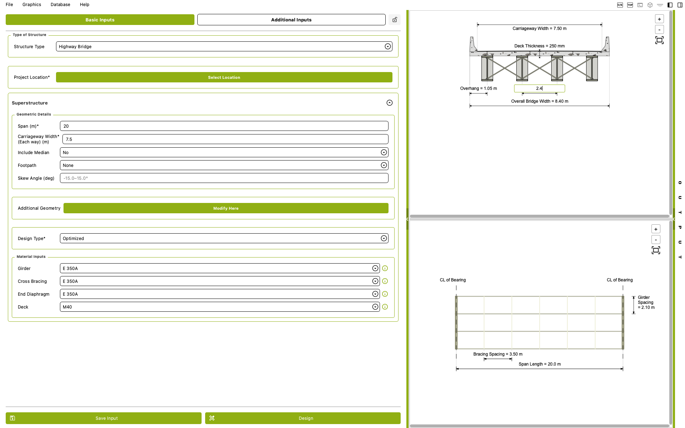
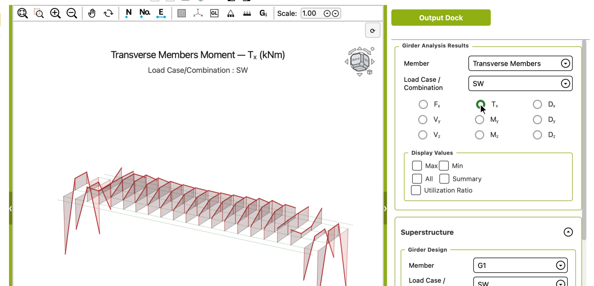

# OsdagBridge Screening Task: UI, 2D CAD and Plotting Enhancements

**Repository:** https://github.com/PranavShukla2/OsdagBridge (branch `dev`)
**Video demonstration:** https://youtu.be/5JGVqugLyJ4

All three subtasks are done on top of the `dev` branch. Below is how I approached each one, which files changed, and how I tested them.

---

## Task I: Interactive 2D CAD parameter editing

### Approach

The 2D CAD widgets (`CrossSectionCADWidget`, `TopViewCADWidget`) paint everything, labels included, with `QPainter`. There's no widget under a label that could receive a click. So I record each label's position while it's being painted:

* `draw_text_with_background()` (and the dimension-arrow helpers that call it) now return the rectangle of the text they drew.
* At each dimension label, the widget registers that rectangle against the CAD parameter it represents (`carriageway_width`, `girder_spacing`, `deck_thickness`, `span_length`).
* Overhang, Overall Bridge Width and Bracing Spacing are registered as **locked**. Double-clicking them only shows a tooltip saying the value is derived. These are calculated values, so letting them be typed in would make the layout over-determined.

The double-click handling lives in a small mixin (`desktop/ui/docks/cad_label_editor.py`) shared by both views:

* `mouseDoubleClickEvent` hit-tests the registered rectangles and places a `QLineEdit` (with a `QDoubleValidator`) over the label, pre-filled with the current value.
* **Enter** or clicking elsewhere (focus-out) applies the value; **Esc** cancels.
* Hovering an editable label shows a pointer cursor, a "Double-click to edit" tooltip and a thin green outline, so it's clear which labels are editable.
* If labels overlap on a small canvas, the one whose centre is nearest the pointer is used. The deck thickness label is now always drawn; before, it disappeared when the slab was under 5 px tall on screen.
* The widget doesn't change any data itself. It only emits `dimension_value_edited(key, value)`, where `key` is the `common.py` input key and the value is already in that key's units. `BridgeDualCADWidget` forwards that signal, and editing is switched on only for the main-page CAD. The Typical Section preview in Additional Inputs reuses the same widget, so it stays read-only.

`template_page.py` handles the signal and writes the value back:

| CAD label | Dictionary key | How it's applied |
|---|---|---|
| Span Length | `KEY_SPAN` | Set on the input-dock line edit, then passed through the dock's existing `_on_field_edited`. This reuses the same validation popups and corrections, and the dock text stays in sync. |
| Carriageway Width | `KEY_CARRIAGEWAY_WIDTH` | Same as span. |
| Girder Spacing | `KEY_TS_GIRDER_SPACING` | Validated with `validate_additional_inputs`, then re-solved with the number of girders fixed. The deck overhang takes up the change, the same rule the Typical Section tab uses. |
| Deck Thickness | `KEY_TS_DECK_THICKNESS` | Validated with `validate_additional_inputs`. |

For girder spacing I moved the solver construction out of `solve_extend_basic_input_dict()` into `_layout_solver()`. I then added `apply_girder_spacing()` in `defaults.py`, so the CAD and the existing code build the solver the same way. Invalid values aren't applied; the user gets the existing warning dialog with the validator's message. After every successful edit `update_cad_from_inputs()` runs, so both views redraw from the dictionary.

While testing I found that the input dock marked a required field as "changed" on every `editingFinished`, which Qt also emits whenever focus just leaves the field. The next CAD refresh then re-ran `solve_extend_basic_input_dict` and reset girder spacing and deck thickness to their defaults. Any value set from the CAD (or the dialog) was lost as soon as you clicked into and out of Span. The dock now remembers the last committed text and raises the flag only when it really differs. A genuine change to span or carriageway width still re-derives the layout, as before.

---

## Task II: Additional Inputs dialog, validation and unsaved changes

### Pre-save validation

I didn't want a hand-written list of parameter names, so the rules are derived from `ADDITIONAL_INPUTS_SCHEMA` (`desktop/ui/dialogs/additional_input/custom_input_rules.py`). Three patterns in the schema mean "Custom needs a value":

1. `TYPE_MODE_LINE` fields: the mode combo `<KEY>.mode` and the value box `<KEY>.value` (wind, seismic, footpath pressure, camber, ...).
2. Comboboxes with a "Custom" choice that unlocks other text fields (crash barrier, median, railing type and load mode, wearing course). For these I added a `custom_inputs: [KEY_...]` list to the field in the schema.
3. `TYPE_ADAPTIVE` member-property fields whose Custom mode is a text box (girder depth and flange widths when the design type is Custom).

The rules carry only `KEY_*` constants from `common.py`. The only new constants are `VALUE_CUSTOM` and the two mode-line object-name suffixes, which the UI builder now also uses instead of literal strings.

On **Save**, `_save_inputs()` walks every enabled top-level tab and checks each rule. A field counts only if its controller is enabled and set to Custom, and the value box is enabled and not deliberately hidden. (A Custom crash barrier hides Density and Area, for example; a page that's simply not the current sub-tab still counts.) If any are empty, saving stops. Every empty field gets the same red border the input dock uses (cleared as soon as you type in it). The dialog switches to the tab holding the first one and focuses it, and the existing `CustomMessageBox` shows one line per field:

> Error: The custom value for 'Crash Barrier - Width (m)' cannot be empty.
> Error: The custom value for 'Wind Load (WL) Inputs - Gust Factor, G' cannot be empty.

The name comes from the field's label in the schema plus the sub-tab/section heading, with HTML such as `` stripped.

### Unsaved-changes warning

* `self.is_modified` is set in `_update_input_dict()` whenever a field's value really changes. Re-typing `2.50` over `2.5` doesn't count.
* When the dialog opens (and again after a successful save), a copy of `working_input_dict` is taken as the saved state. It's taken after `showEvent` has finished, because opening the dialog fills widgets and recomputes values in code and those mustn't count as edits.
* `closeEvent` is overridden. If there are unsaved edits, it shows the warning dialog, *"You have unsaved changes. Closing this window will discard them. Do you want to proceed?"*, with **Discard / Cancel**. Cancel keeps the dialog open. Discard restores the saved state and closes.
* Esc closes a `QDialog` through `reject()` and never reaches `closeEvent`, so `reject()` is overridden too, with a guard so the title-bar close doesn't ask twice.
* Selector combos (select girder / member ID for girder details, stiffeners, end diaphragms and cross bracing) are ignored. Switching which girder you're looking at isn't an edit.

---

## Task III: Result plotting for transverse members

### Data side (`results_data.py`)

`classify_members(nodes, members, model, edge_dist)` splits the grillage elements:

* With the ospgrillage model available, the transverse tags come from the model's own groups: `start_edge` + `end_edge` are the **end diaphragms**, and `transverse_slab` is the **intermediate cross bracings**. Everything else is longitudinal. Without a model it falls back to geometry: an element whose two nodes share the same z lies along a girder line.
* With an overhang (`edge_dist > 0`) the outermost lines are edge beams. Transverse pieces running out to them are deck cantilever, not bracing between girders, so they go into a separate `deck_overhang` list.
* `_build_full_data()` now uses this classification. `transverse_members` therefore holds only girder-to-girder members, and `end_diaphragm_members` / `cross_bracing_members` are added to the output.

There are also two extraction helpers that take a single load-case slice of the dataset: `member_end_forces()` returns i/j end forces in kN/kNm, and `node_displacements()` returns mm, with y/z flipped like the girder deflection plot. `transverse_lines()` groups transverse elements into the cross lines across the width. `PlateGirderBridge.get_member_classification()` exposes the split to the UI.

For the 20 m / 7.5 m test bridge (4 girders, 2 edge beams), this gives 78 longitudinal elements, 6 end-diaphragm elements, 36 cross-bracing elements and 28 deck-overhang elements on 14 cross lines.

### UI side

* The analysis **Member** dropdown in the output dock now ends with **Transverse Members**, after `All, G1 … Gn`.
* `MplPlotWidget.update_plot()` calls the new `build_figure_transverse()` when it's selected. Every component radio works (Fx, Vy, Vz, Tx, My, Mz, Dx, Dy, Dz), and the diagram is redrawn when the load case/combination changes.
* End diaphragms and cross bracings are drawn as one component, as the task asks. Each element is drawn from its i-end to its j-end value. The sign convention is the same as the girder diagrams: the value at a node is the i-end force of the element starting there, so the j-end force is negated. Moments plot positive-down like the girder BMD.
* The existing toolbar toggles work on the new plot: max/min markers, all values, node and element numbers. The summary overlay gives max/min separately for End Diaphragms and Cross Bracings.
* The cross lines overlap in a straight front elevation, so this plot opens with a slightly oblique camera. The camera is kept while you switch component or load case, and reset only when switching between girder and transverse plots.

---

## Testing

Unit tests (`tests/unit/test_results_classification.py`, `tests/unit/test_ui_enhancements.py`, run with `pytest tests/unit`) cover:

* the member classification on a synthetic grillage, with and without overhang, including model groups taking priority over geometry;
* force/displacement extraction and units;
* rules derived from the schema, and label cleaning;
* `apply_girder_spacing`, valid and impossible layouts;
* the CAD label editor in an offscreen Qt session: double-click, type, Enter emits the right key and value; Esc cancels; locked labels don't open; editing is off by default.

For the full flows I also wrote small scripts that build the real `CustomWindow` offscreen and drive it with `QTest`, with message boxes stubbed so nothing blocks:

* **Task I:** double-click on each label opens the editor, Enter and focus-out apply, Esc cancels. Girder spacing 2.4 m re-solved the overhang to 0.60 m in both views. Span and carriageway edits updated the dock text. Span 500 went through the dock's validation and was corrected to 45 m with its popup. Deck thickness 50 was rejected with the validator message. A double-click on Overhang opens nothing.
* **Task II:** Custom crash barrier with an empty Width gives the error naming the field and focuses it. An empty Custom gust factor on the Loading tab switches to that tab. Close with no changes closes silently; close after an edit with Cancel stays open; Esc with Discard closes and the edit is gone on reopen.
* **Task III:** ran a full design (span 20 m, carriageway 7.5 m), then checked the dropdown entries, every component, and switching load case (summary values change, e.g. Vy on SW vs DD) and back to G2.

## Files changed

* `desktop/ui/docks/cad_label_editor.py` (new), `cad_cross_section.py`, `cad_top_view.py`, `cad_dual_view.py`
* `desktop/ui/template_page.py`
* `core/bridge_types/plate_girder/defaults.py`
* `desktop/ui/dialogs/additional_input/custom_input_rules.py` (new), `additional_inputs.py`, `ui_builder/common_ui_builder.py`
* `core/bridge_types/plate_girder/ui_fields_additional_input.py`, `core/utils/common.py`
* `core/bridge_types/plate_girder/results_data.py`, `results_data_post_processing.py`, `plot_generator.py`, `plategirderbridge.py`
* `desktop/ui/mpl_plot_widget.py`, `desktop/ui/docks/output_dock.py`

## Setup note (macOS arm64)

The `osdag` 2026.x conda package depends on `osdag_latex_env` and `navcube`, and neither is published for osx-arm64. The solver therefore falls back to `osdag` 2025.01, which doesn't include `osdag_core`. I installed `osdag` 2026.04 with `--no-deps`, then `PySide6` and `navcube` with pip. The conda Qt that `pythonocc-core` pulls in also leaves a `qt.conf` that hides PySide6's platform plugins, so `QT_PLUGIN_PATH` has to point at `site-packages/PySide6/Qt/plugins`.
